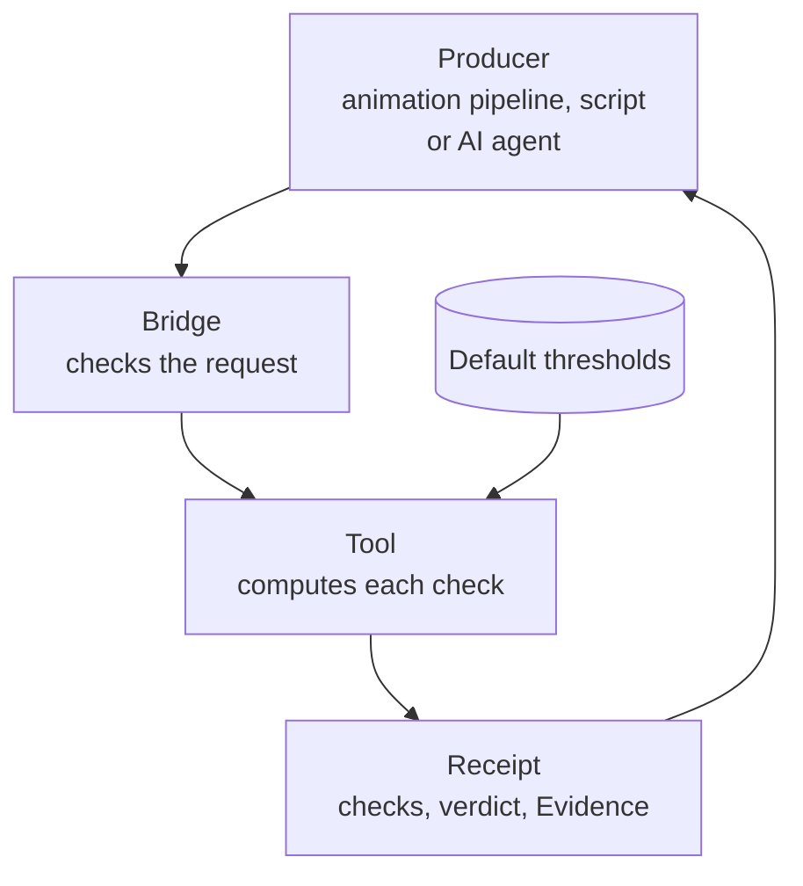

# foundation-robotics

A read-only checker that tells you whether motion numbers obey physics: walk timing for a body's size, gait, balance, joint chains, mechanisms, and squash and stretch. It is a *Foundation*: a checker kept separate from the program whose work it judges (see [Where it fits](#where-it-fits)).

> [!IMPORTANT]
> **Results are observations, not engineering approvals.** A pass means the numbers you sent met thresholds that, for the most part, no qualified person has approved yet. Nothing here is a safety determination or a clinical assessment, and nothing here commands a robot or machine. Do not use a result as the only basis for a decision about a real robot, machine or person.

 

## What it does for you

Motion that breaks physics looks wrong, even when no one can say why. A character scaled up to giant size but animated with human timing looks like a toy. A walk whose feet cover less ground than the body travels looks like skating. A gear train whose wheels turn at the wrong ratio looks broken.

This repository turns those hunches into numbers. A program (an animation pipeline, a robotics script or an AI agent) sends the measurements it already has, such as speed, stride, leg length, joint angles or gear teeth. Each check comes back as a value, the allowed range and `pass` or `fail`, along with **Evidence**: the published source behind each threshold and whether a qualified person has approved it.

The checks only judge the numbers you send. They never see a video, a model file or a robot. You get the numbers out of your animation tool, motion capture or robot logs with your own script; this repository ships no exporter.

Why "robotics"? The same physics applies to robots and to animated characters. So far most thresholds have been tried on animated character walks, so animation review is the best-tested use today.

## How it works



The bridge checks each request's size, integers and message shape. The tool checks its arguments and compares the results with the bundled default thresholds, which record the cases they were tried on. The receipt carries the checks and verdict, Evidence, the request hash and the boundary flags.

The **bridge** is the small server process your program talks to. It speaks JSON-RPC 2.0 over standard input and output, one message per line. You start it, send `initialize`, then any number of `tools/call` requests, then close stdin. All values cross the wire as integers, and each field name ends in its unit: `leg_length_mm`, `cycle_ms`, `froude_permille` (per-mille: 1000 means 1.0). Integers avoid floating-point rounding differences on the wire, and receipts hold no clock time or random values, so the same request always gives the same answer.

It borrows MCP's method names (`initialize`, `tools/call`) but is not an MCP server, so an MCP client cannot connect to it directly. The protocol is kept small and strict on purpose, so a host can check every message exactly. From your own code, start the bridge as a child process and write JSON lines to it. To give it to an AI agent, run it through a host such as Cstack, or wrap that child process in a tool of your own. There is no pip package; the bridge is the supported interface.

The tool's full answer is called a **receipt**: the checks and verdict plus Evidence, the request hash and fixed boundary flags (`observation_only: true`, `acceptance_decision: false`, `control_action: false`).

## Example

Check two walks for a person with a 900 mm leg. Both claim the body moves at 1.4 m/s with a 1.4 m stride. The first takes one stride per second; the second takes 1.6 seconds per stride, which only covers 0.875 m/s, so its feet would have to slide. Run this from the repository root:

```sh
printf '%s\n' \
  '{"jsonrpc":"2.0","id":1,"method":"initialize","params":{"protocolVersion":"foundation-robotics-jsonrpc/1"}}' \
  '{"jsonrpc":"2.0","id":2,"method":"tools/call","params":{"name":"gait_check","arguments":{"gait":"walk","leg_length_mm":900,"speed_mm_s":1400,"stride_mm":1400,"cycle_ms":1000}}}' \
  '{"jsonrpc":"2.0","id":3,"method":"tools/call","params":{"name":"gait_check","arguments":{"gait":"walk","leg_length_mm":900,"speed_mm_s":1400,"stride_mm":1400,"cycle_ms":1600}}}' \
  | python3 -B -m foundation_robotics_bridge \
  | tail -n +2 | python3 -c '
import json, sys
for line in sys.stdin:
    reply = json.loads(line)
    content = reply["result"]["structuredContent"]
    print("walk", reply["id"] - 1, "->", content["assessment"])
    for check in content["receipt"]["result"]["checks"]:
        print("  %(check)-28s %(value)5d  allowed %(min)d..%(max)d  %(status)s" % check)
'
```

The bridge writes one reply line per request. `tail -n +2` drops the reply to `initialize`; the short Python script then prints each check. To see the raw replies, stop the pipeline after the bridge command. (`-B` only stops Python writing `.pyc` files into the checkout.)

Output:

```text
walk 1 -> thresholds_met
  froude_permille                222  allowed 50..500  pass
  stride_ratio_permille         1062  allowed 700..1400  pass
  kinematic_mismatch_permille      0  allowed 0..20  pass
walk 2 -> thresholds_not_met
  froude_permille                222  allowed 50..500  pass
  stride_ratio_permille         1062  allowed 700..1400  pass
  kinematic_mismatch_permille    600  allowed 0..20  fail
```

What this tells you:

- `froude_permille` is the Froude number, speed² / (gravity x leg length), times 1000. People walk below about 0.5 and switch to running above it. Both walks are at 0.222.
- `stride_ratio_permille` compares the stride with what a body this size normally takes at this speed, using a relation R. McN. Alexander fitted across walking and running animals. Both are at 1.06 times the prediction.
- `kinematic_mismatch_permille` compares the claimed speed with stride / cycle time. The second walk is 60 % off, so it fails.

Each receipt also lists the Evidence behind these thresholds, with a status. `RECORDED` means a physical relation or measured ratio taken from a cited source; the walk-to-run limit, for example, cites Alexander (1989). `CHECK` means "still to be checked": a threshold tried on a few known-good and known-bad walks but not yet signed off by a qualified person, such as a biomechanics or robotics engineer. The stride band is one. No threshold is signed off yet. The [tutorial](docs/guides/tutorials/first-check.md) walks through a full session, including a refused request.

## Where it fits

This is one of several **Foundations**: small, read-only checker programs, one per subject area. The program that produced the work (a person's tool, a script, or an AI agent) sends a Foundation its result or question, and the Foundation answers with an observation and the evidence behind it. A Foundation checks and reports but never acts, and it is kept separate from the producer so that nothing marks its own work. [Cstack](https://github.com/Akilleez-QA/cstack) is a host that runs Foundations for AI agents and checks each one's file hashes before starting it, but you don't need Cstack: any program that can start a process and write a line of JSON can use this one.

## Try it

You need Python 3.11 or newer (CI tests 3.12; the suite also passes on 3.11). Nothing is installed; the code runs from the checkout and uses only the standard library.

```sh
git clone https://github.com/Akilleez-QA/foundation-robotics
cd foundation-robotics
python3 -B -m unittest discover -s tests -t .
```

The last line is `OK`. Then paste the example above.

## Tools

| Tool | What it answers |
|---|---|
| `scale_timing` | How a body of this size should move under gravity: time and speed factors against an adult, walking speed, stride and cadence, swing periods, fall times |
| `gait_check` | Is this walk, run or stand plausible? Froude band, stride for the body's size, speed = stride / cycle, time each foot is down, foot slide and left/right symmetry |
| `balance_check` | Is this body balanced in each frame? Centre of mass over the feet, zero-moment point inside the support area, whether it can stop, free fall at g in the air |
| `ik_check` | Does this joint chain reach where it should? Joint limits, reach, tip error against a target, and how close the pose is to locking up (a singularity) |
| `mechanism_check` | Does this machine move the way its geometry says? Gear ratios and directions, mesh timing, slider-crank and four-bar linkages, and rotors that appear frozen at the frame rate |
| `squash_check` | Does squash and stretch keep the volume constant? And what side scale would? |

Every argument, default threshold and result field is in the [tool catalog](docs/guides/reference/tool-catalog.md). [How the checks work](docs/guides/explanation/how-the-checks-work.md) explains the physics behind each one.

## Limitations

- **Observations, not engineering approvals.** A verdict judges the numbers you sent against thresholds. It cannot tell whether those numbers describe the real motion.
- Most thresholds are marked `CHECK`: tried on a few known-good and known-bad cases, mostly human-scale walks, and not approved by a qualified person.
- The checks do not model masses, torques or contact forces (apart from the simple balance model and free fall), and do not check strength, wear or fatigue.
- Nothing here controls or monitors hardware.

Read [Limitations and safety-relevant use](docs/guides/explanation/limitations.md) before using any result outside animation review or research.

## Learn more

- [Tutorial: your first motion check](docs/guides/tutorials/first-check.md)
- [How-to guides](docs/guides/how-to/README.md): override a threshold, send z-up coordinates, troubleshoot an error
- [Tool catalog](docs/guides/reference/tool-catalog.md): every argument, range and result field
- [How the checks work](docs/guides/explanation/how-the-checks-work.md): the physics and sources
- [Interface](docs/icd/icd-cstack.md): the bridge protocol, errors and size limits
- [Documentation index](docs/README.md)

## What is inside

| Path | Contents |
|---|---|
| `foundation_robotics/` | The checks, the cited sources and the default thresholds with their calibration cases |
| `foundation_robotics_bridge/` | The stdio JSON-RPC bridge and tool schemas |
| `tests/` | Unit, bridge and documentation tests |
| `tools/` | Source-manifest, trace and link check, documentation and report generators |
| `SOURCE-MANIFEST.json` | SHA-256 of every shipped file, so a host can check nothing changed |

## Related projects

- [Cstack](https://github.com/Akilleez-QA/cstack): a host that runs Foundations for AI agents.
- Sibling Foundations: [foundation-refrigeration](https://github.com/Akilleez-QA/foundation-refrigeration) (refrigeration data) and [foundation-film](https://github.com/Akilleez-QA/foundation-film) (film production).
- [foundation-template](https://github.com/Akilleez-QA/foundation-template): the starting point for a Foundation in a new subject.

## Engineering records

Version 0.1.0, not yet tagged. CI runs the tests on Python 3.12 in normal and optimized (`-O`) mode, checks the source manifest and scans for leaked secrets; the latest [test report](docs/verification/reports/README.md) has per-test results.

The project also keeps formal engineering records, organized after NASA software documentation guidance. Most readers never need them. The classification, requirements, design, interface, data dictionary, test plan, verification matrix, configuration management and assurance records are listed under [Engineering records](docs/README.md#engineering-records) in the documentation index.

Contributing: [CONTRIBUTING.md](CONTRIBUTING.md). Security reports: [SECURITY.md](SECURITY.md). Help: [SUPPORT.md](SUPPORT.md).

## License

Copyright 2026 Refrigeration.AI. Licensed under the GNU General Public License v3.0 only (GPL-3.0-only). If you want to use it to create a product or service under different terms, commercial licenses are available from Refrigeration.AI. Contact craig@nh3.biz.
