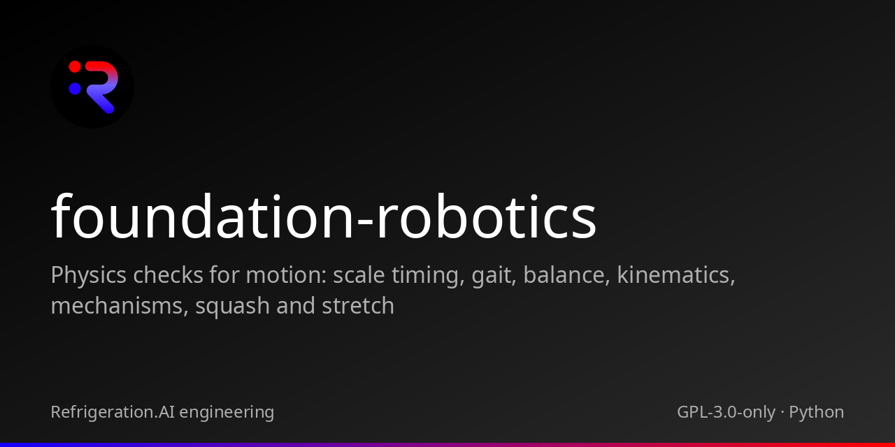

<p align="center"></p>

# foundation-robotics

Physics checks for motion: scale timing, gait, balance, kinematics, mechanisms, squash and stretch

 

## Family

| Repository | Role | Relation |
|---|---|---|
| [cstack](https://github.com/Akilleez-QA/cstack) | Runs Foundations behind pinned adapters under one human approver | Host |
| [foundation-engine](https://github.com/Akilleez-QA/foundation-engine) | TypeScript and three.js framework for browser games | Foundation |
| [foundation-math](https://github.com/Akilleez-QA/foundation-math) | Exact mathematical kernels and physics research tools | Foundation |
| [foundation-film](https://github.com/Akilleez-QA/foundation-film) | Film-production acceptance checks | Foundation |
| [foundation-refrigeration](https://github.com/Akilleez-QA/foundation-refrigeration) | Refrigeration data and checks | Foundation |
| [foundation-robotics](https://github.com/Akilleez-QA/foundation-robotics) | Physics checks for motion | Foundation |
| [foundation-template](https://github.com/Akilleez-QA/foundation-template) | Minimal Foundation to copy for a new domain | Foundation |
| [endoforge](https://github.com/Akilleez-QA/endoforge) | Workshop for running coding agents with checks and receipts | Tool |
| [poodo](https://github.com/Akilleez-QA/poodo) | Reasoning skill that shows evidence before it acts | Tool |

## Status

Version 0.1.0, no release tag yet. Six read-only tools behind a stdio JSON-RPC bridge, standard library only. Every result carries Evidence and an input hash. A verdict is an observation, not an acceptance decision.

Classification: self-assessed Class E analog (research and general-purpose software), not safety-critical. Class E holds only because no real engineering decision depends on this software. This is not a NASA compliance determination. See the [software management plan](docs/plan/software-management-plan.md#1-software-classification-self-assessed).

## Quickstart

Requires Python 3.11 or newer. Nothing is installed.

```
git clone https://github.com/Akilleez-QA/foundation-robotics
cd foundation-robotics
python -B -m unittest discover -s tests -t .
python -B tools/build_manifest.py
```

The tests print `OK`. The manifest tool prints the file count, the manifest SHA-256 and the tool inventory SHA-256 that a host pins. To send your first request to the bridge, follow the [tutorial](docs/guides/tutorials/first-check.md).

## What is inside

| Tool | Purpose |
|---|---|
| `scale_timing` | Expected timing for a body of this size under gravity (dynamic similarity): time, speed and strength factors against a reference adult, walking speed, stride and cadence at chosen Froude numbers, leg and appendage swing periods, fall times |
| `gait_check` | Judge a walk, run or stand: Froude band, stride against Alexander's relation, speed = stride / cycle, duty factor, foot slide scaled to leg length, and left/right step symmetry |
| `balance_check` | Judge balance per frame: COM over the support polygon (static), ZMP inside it (dynamic), capture point inside it at the end (stop), and free fall at g in flight |
| `ik_check` | Judge a joint chain per pose by forward kinematics: joint limits, reach, tip error against a target, and distance from singularity (Jacobian singular-value ratio) |
| `mechanism_check` | Judge a machine's motion against its geometry: gear-train speed ratios and senses, mesh phase lock, slider-crank position, four-bar Grashof class and output angle, rotor strobing at the frame rate |
| `squash_check` | Judge squash and stretch for constant volume per frame, with the side scale that would keep it |

## Measured

Test results for the documented baseline, with commit, environment and per-test outcomes, are in the latest generated [test report](docs/verification/reports/README.md). CI runs the suite in normal and `-O` modes on Python 3.12, verifies the source manifest and runs gitleaks.

## Limitations

- Outputs judge numbers the caller supplies. They are not engineering approvals, safety determinations or clinical assessments, and the software commands no hardware.
- Most thresholds are still marked `CHECK`: tried on a few known-good and known-bad cases, not approved by a qualified person.
- Do not use the results as the sole basis for any decision about a real robot, machine or person. Read [Limitations and safety-relevant use](docs/guides/explanation/limitations.md) first.

## Documentation

See [docs/README.md](docs/README.md): tutorial, how-to guides, tool reference, explanation, and the control documents (management plan, requirements, design, interface, data dictionary, test plan, verification matrix, configuration management, test reports, version descriptions, assurance record).

## Layout

| Path | Contents |
|---|---|
| `foundation_robotics/` | Domain package |
| `foundation_robotics_bridge/` | stdio JSON-RPC bridge and schemas |
| `tests/` | Unit, bridge and documentation tests |
| `tools/` | Manifest tool, trace and link check, documentation and report generators |
| `docs/` | Control documents and guides |
| `SOURCE-MANIFEST.json` | SHA-256 of every shipped source file outside `.github/` |

## Contributing

See [CONTRIBUTING.md](CONTRIBUTING.md). Help: [SUPPORT.md](SUPPORT.md).

## Security

See [SECURITY.md](SECURITY.md).

## License

This project is available under the GNU General Public License v3.0 only (GPL-3.0-only). If you want to use it to create a product or service under different terms, commercial licenses are available from Refrigeration.AI. Contact craig@nh3.biz.
