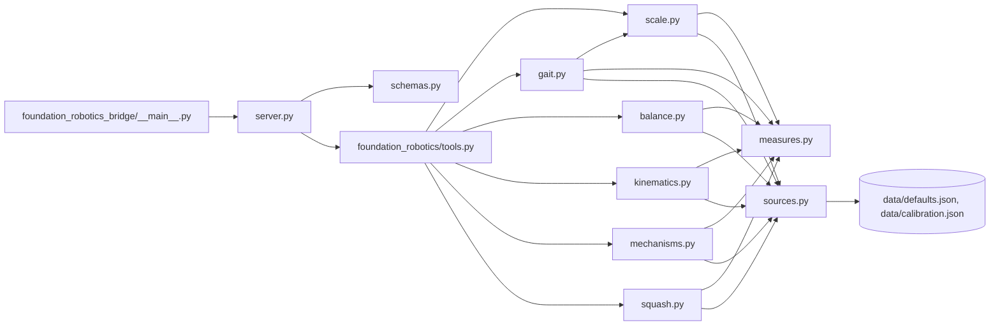
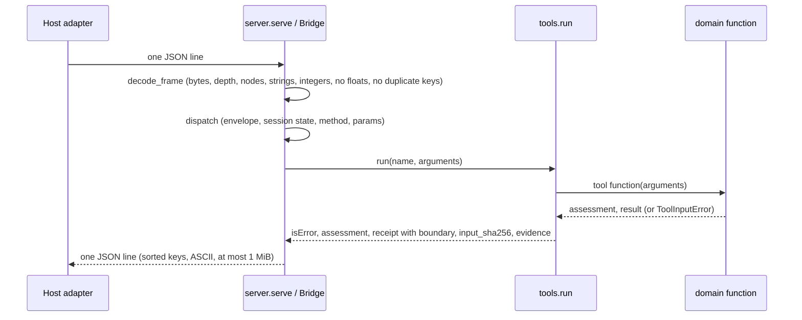

# foundation-robotics software design description

| Field | Value |
|---|---|
| Document ID | FROBO-SDD |
| Version | 2.1 |
| Status | Draft |
| Owner | Akilleez-QA |
| Date | 2026-11-09 |
| Baseline commit | b4de079f2d99114e5efe6b204704df57d392e454 |
| Applies to | foundation-robotics main at baseline commit |
| Classification | Self-assessed Class E analog; not safety-critical (see SMP §1) |

> Organized after [NPR 7150.2D](https://nodis3.gsfc.nasa.gov/displayAll.cfm?Internal_ID=N_PR_7150_002D_&page_name=all), [NASA-STD-8739.8B](https://standards.nasa.gov/standard/nasa/nasa-std-87398) and the [NASA Software Engineering Handbook](https://swehb.nasa.gov/display/SWEHBVD/7.18+-+Documentation+Guidance) documentation guidance. This is not a NASA compliance determination or certification. The software classification is a self-assessed analog (Class E, not safety-critical); no NASA authority, independent verification and validation, or hazard analysis is asserted. The document describes the implementation inspected at the baseline commit.

## 1. Purpose and design boundary

foundation-robotics is one Foundation. A Foundation owns the meaning, data and acceptance checks of one domain; here, physical plausibility of motion for animation and robotics. POODO governs how it is used. The host (Cstack, through its stdio adapter) starts the bridge, pins its source and validates every result.

The boundary: the Foundation receives numbers the caller already measured (positions, speeds, angles, scales) and returns observations. It never sees a clip, a rig or a file, and it never commands anything.

## 2. Design decisions and trade-offs

| Decision | Alternatives considered | Rationale | Requirements |
|---|---|---|---|
| Read-only observations with a fixed `boundary` block | Return pass/fail decisions | A verdict is evidence for a person or host, not an acceptance | REQ-ROB-008 |
| Standard library only | numpy/scipy for linear algebra | The whole source tree can be hashed and pinned; the 3x3 eigenproblem is solved by Jacobi rotation in `kinematics.eigen_symmetric` | REQ-ROB-007, REQ-ROB-011 |
| Integers only on the wire, in milli-SI units and per-mille ratios | Floats | Exact, reproducible input hashes; no NaN or infinity; rounding happens once in `measures.rnd` | REQ-ROB-010, REQ-ROB-012 |
| Every default in `data/defaults.json` with a status and a source | Constants in code | Thresholds stay visibly `CHECK` until a person approves them; receipts say which values were defaults | REQ-ROB-018 |
| Calibration cases replayed by the suite | Thresholds tuned by hand | A threshold change that flips a known case fails the build | REQ-ROB-017 |
| Own JSON-RPC protocol string, `mcpCompatible: false` | MCP | Smaller surface; the host adapter controls framing and limits | REQ-ROB-013 |
| Argument errors become receipts, wire errors become JSON-RPC errors | One error channel | A refused tool call still carries evidence and an input hash | REQ-ROB-015, REQ-ROB-009 |

## 3. Architecture overview

Static view:

Runtime view (one `tools/call`):

## 4. Components

| ID | Path | Responsibility | Inputs and outputs | Requirements |
|---|---|---|---|---|
| C-SCALE | `foundation_robotics/scale.py` | Leg length from caller or Winter hip height; dynamic-similarity factors; walk table; pendulum and fall times | arguments to `timing_estimated` result | REQ-ROB-001 |
| C-GAIT | `foundation_robotics/gait.py` | Foot-track analysis (strikes, stance, stride, slide), Froude, stride ratio, kinematic mismatch, duty, asymmetry | arguments to verdict and checks | REQ-ROB-002 |
| C-BALANCE | `foundation_robotics/balance.py` | Convex hull of contacts, signed margins, Savitzky-Golay derivatives of the COM, cart-table ZMP, capture point, flight gravity | arguments to verdict and per-frame margins | REQ-ROB-003, REQ-ROB-019, REQ-ROB-020 |
| C-IK | `foundation_robotics/kinematics.py` | Product-of-exponentials forward kinematics, positional Jacobian, singular values by Jacobi rotation | arguments to verdict and per-pose rows | REQ-ROB-004 |
| C-MECH | `foundation_robotics/mechanisms.py` | Gear trains with shaft coupling, mesh phase, slider-crank, four-bar (Grashof, loop closure), rotor strobe | arguments (one of five kinds) to verdict and detail | REQ-ROB-005 |
| C-SQUASH | `foundation_robotics/squash.py` | Volume per frame and the conserving lateral scale | arguments to verdict and per-frame rows | REQ-ROB-006 |
| C-MEASURES | `foundation_robotics/measures.py` | Shared argument validation, bounds, rounding, `check` and `verdict`, threshold merge, gravity and up-axis | values to validated values or ToolInputError | REQ-ROB-015, REQ-ROB-021 |
| C-SOURCES | `foundation_robotics/sources.py`, `foundation_robotics/data/defaults.json`, `foundation_robotics/data/calibration.json` | Load defaults and calibration once at import; citation texts | none to dictionaries | REQ-ROB-017, REQ-ROB-018 |
| C-TOOLS | `foundation_robotics/tools.py` | Tool table, Evidence entries per tool, input hash, boundary block, error capture | name and arguments to isError, assessment, receipt | REQ-ROB-008, REQ-ROB-009, REQ-ROB-010, REQ-ROB-015 |
| C-SERVER | `foundation_robotics_bridge/server.py`, `foundation_robotics_bridge/__main__.py` | Line framing, wire limits, JSON-RPC envelope, session state, response encoding, exit codes | stdin bytes to stdout bytes | REQ-ROB-011, REQ-ROB-012, REQ-ROB-013, REQ-ROB-016 |
| C-SCHEMAS | `foundation_robotics_bridge/schemas.py` | JSON Schema (2020-12) input and output schema per tool; catalog order | none to tool definitions | REQ-ROB-014, REQ-ROB-022 |
| C-MANIFEST | `tools/build_manifest.py`, `SOURCE-MANIFEST.json` | Hash the shipped tree; print file count, manifest SHA-256 and inventory SHA-256 | tree to manifest and pins | REQ-ROB-007 |
| C-DOCTOOLS | `tools/check_trace.py`, `tools/gen_docs.py`, `tools/gen_reports.py` | Trace and link check; generated reference pages, with every schema field including union branches and map values; generated test report and version description, whose verdict fails on any non-ok outcome, trace problem or stale manifest | docs and tests to pass/fail and generated pages | REQ-ROB-023, REQ-ROB-024 |

`foundation_robotics/__init__.py` and `foundation_robotics_bridge/__init__.py` hold only `__version__ = "0.1.0"`.

## 5. Execution concept

- One process per session, single-threaded. `serve` reads one line at a time (a line over 65537 bytes including its newline is rejected), answers it, flushes, and repeats until end of input.
- Session state is one flag, `Bridge.initialized`. `ping` and `initialize` work at any time; `tools/list` and `tools/call` need it set.
- Tool functions are pure: same arguments give the same result. Defaults and calibration are read once at import from the package's own `data/` directory.
- No timeouts or cancellation inside the bridge. Work per call is bounded by the input limits (for example 1200 frames per foot track, 400 balance frames, 200 IK poses, 1000 mechanism or squash frames). The host owns wall-clock timeouts.
- Responses are serialized with sorted keys, compact separators and ASCII only, so equal results give equal bytes.

## 6. Interfaces

- External: the [Cstack stdio interface](../icd/icd-cstack.md). Field-level reference: [tool catalog](../guides/reference/tool-catalog.md), generated from `schemas.py`.
- Internal: `tools.run(name, arguments) -> (isError, assessment, receipt)` is the only call from the bridge into the domain package. Each domain function returns `(assessment, result)` or raises `ToolInputError`.

## 7. Failure handling and containment

| Failure | Handling | Where |
|---|---|---|
| Malformed or out-of-profile frame | JSON-RPC error with `id: null`; session continues | `Bridge.handle` |
| Oversized or unterminated line | One `-32002` error, then exit status 2 | `serve` |
| Bad envelope, method or params | JSON-RPC error; session continues | `Bridge.dispatch` |
| Bad tool arguments | Receipt with `status: error`, `result: null`, Evidence | `tools.run` |
| Non-finite derived value | Raised as ToolInputError, so it becomes a refused receipt | `measures.rnd` |
| Unexpected exception | `-32603`, no result | `Bridge.dispatch` |
| Response over 1 MiB or not serializable | Replaced by an error, "Result withheld" | `encode_response` |
| Broken pipe or OS error | Exit status 2 | `serve` |

Nothing is retried.

## 8. Resource use

Memory is bounded by the input frame limit (64 KiB per request) and the array limits in the schemas. No files are written, no subprocesses are started and no network is used. Timing has not been measured; no timing claim is made.

## 9. Quality attributes

- Testability: pure functions plus subprocess-level bridge tests; test counts and results are in the latest [test report](../verification/reports/README.md).
- Security: fail-closed parsing, no caller paths, no options, integer-only numbers. See [SECURITY.md](../../SECURITY.md).
- Maintainability: one module per tool, shared validation in `measures.py`, every number's source in `defaults.json`.
- Reproducibility: deterministic serialization and a source manifest the host can pin.

## 10. Assumptions and limitations

- Inputs are the caller's measurements; the Foundation cannot check that they came from the motion they claim to describe.
- Most thresholds are `CHECK` (not yet approved by a qualified person); see the [defaults table](../data/defaults.md).
- The ZMP uses the cart-table model, which ignores angular momentum about the COM, so a pass is necessary, not sufficient.
- Mixed revolute and prismatic chains give a singular-value ratio with mixed units; the receipt says so.
- The input schemas do not encode every rule. For example, "exactly one of `leg_length_mm` and `height_mm`" is enforced in code only, so a schema-valid request can still be refused.
- See [Limitations and safety-relevant use](../guides/explanation/limitations.md).

## Change history

| Version | Date | Commit | Change | Reviewed in |
|---|---|---|---|---|
| 1.0 | 2026-10-30 | d779a9f | Context, components, tools, data flow, decisions | Initial commit |
| 2.0 | 2026-11-08 | b4de079 | Family standard: metadata, decisions table, static and runtime views, component IDs with requirements, execution, failure handling, resources, quality attributes, limitations | docs/nasa-standard PR |
| 2.1 | 2026-11-09 | d5bbe35 | C-DOCTOOLS allocated REQ-ROB-023 and REQ-ROB-024 | PR fixing the 2026-11-09 backfill-review findings |
